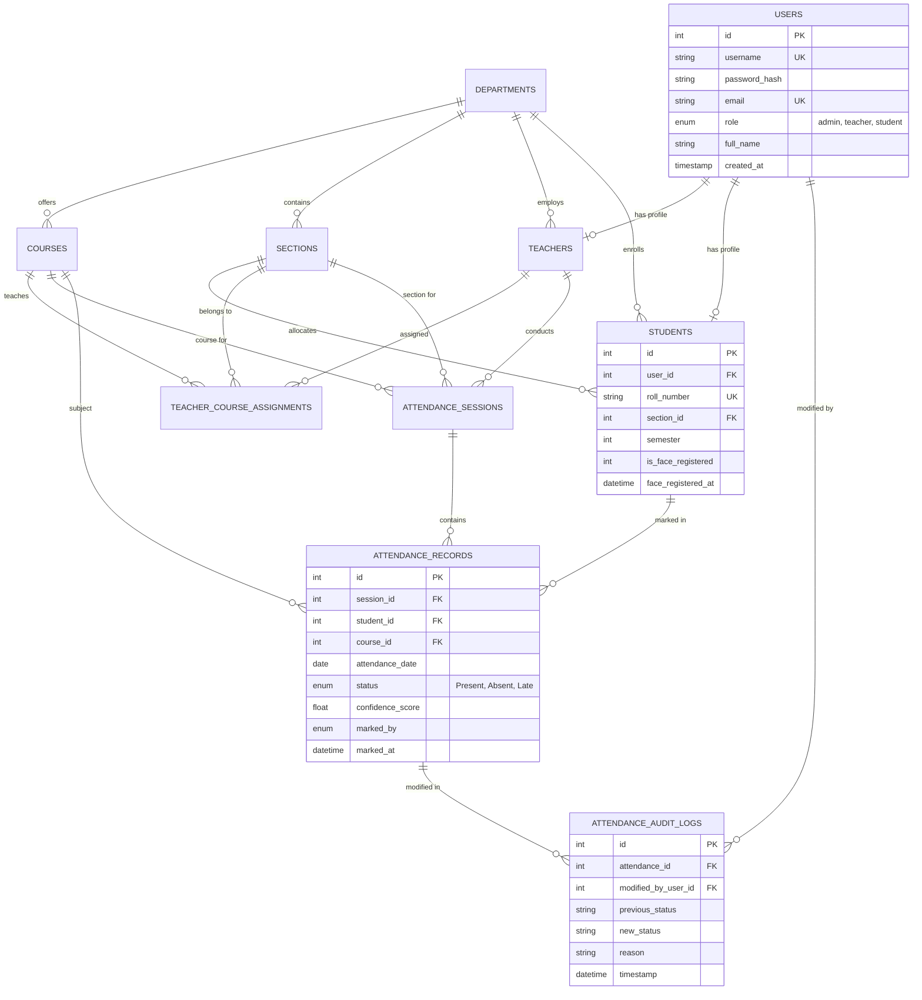
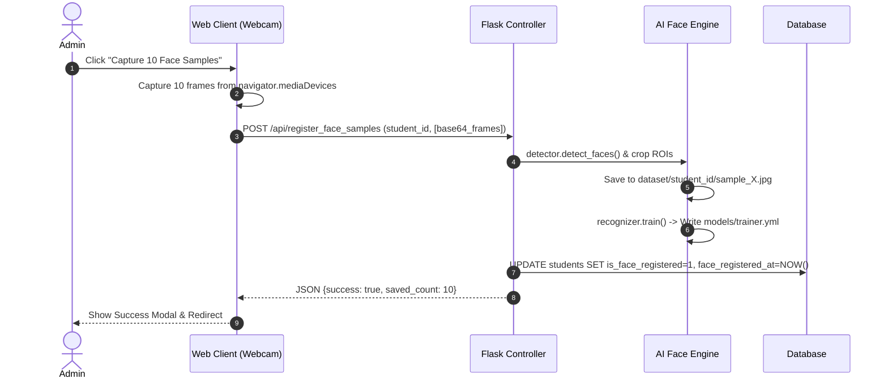
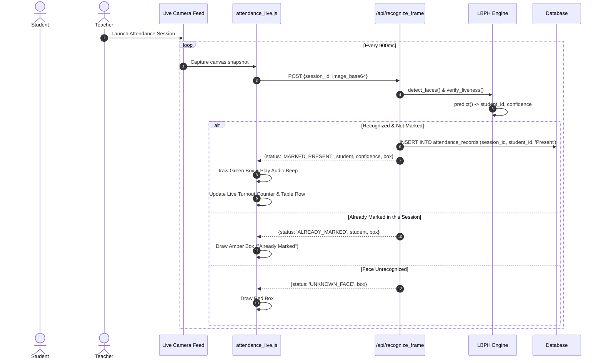

# FINAL YEAR PROJECT DOCUMENTATION
## AI-Based Smart Attendance System

---

## 1. Abstract

Traditional attendance management methods in universities and colleges rely heavily on manual paper roll calls or RFID swipe cards. These conventional approaches consume up to 10–15% of instructional lecture time and are vulnerable to human errors, paper misplacement, and proxy attendance (buddy punching). 

The **AI-Based Smart Attendance System** presents an automated, secure, and privacy-conscious biometric solution integrating Computer Vision, Machine Learning, and Web Technologies. The system combines multi-scale **OpenCV Haar Cascades** for real-time face detection, **Local Binary Patterns Histograms (LBPH)** for facial feature classification, and a **Python Flask** web application supported by a dual-engine database architecture (**MySQL** / **SQLite**). 

The system delivers role-based dashboards for Administrators, Teachers, and Students, live camera scanning with anti-proxy duplicate prevention, automated low-attendance warnings (< 75%), manual correction workflows governed by immutable audit logging, and automated Excel and PDF export facilities.

---

## 2. Problem Statement & Research Objectives

### 2.1 Problem Statement
1. **Time Consumption**: Manual roll calling in classrooms with 50+ students occupies significant lecture time.
2. **Proxy Attendance**: Students easily sign on behalf of absent peers in paper registers or swipe borrowed RFID cards.
3. **Data Loss & Calculation Errors**: Physical sheets are susceptible to physical damage, loss, and computational errors during monthly percentage compilations.
4. **Lack of Transparency**: Students often remain unaware of their attendance deficits until they are barred from final semester examinations.

### 2.2 Objectives
- Automate student attendance recording using non-intrusive facial recognition via standard webcams.
- Eliminate proxy attendance through algorithmic biometric matching and cooldown intervals.
- Guarantee audit accountability for any manual teacher modifications.
- Deliver automated compliance alerts for students falling below the mandatory **75% threshold**.
- Provide instant one-click report generation in **PDF** and **Excel** formats.

---

## 3. Technology Stack

| Layer | Technologies Selected | Justification |
| :--- | :--- | :--- |
| **Frontend** | HTML5, CSS3, JavaScript (ES6+), Bootstrap 5.3, Bootstrap Icons | Responsive, clean academic user interface; native HTML5 WebRTC camera access with zero third-party browser plugins. |
| **Backend** | Python 3.14+, Flask 3.1, Jinja2 | Lightweight WSGI microframework offering rapid RESTful routing, modular blueprints, and seamless OpenCV integration. |
| **Computer Vision / AI** | OpenCV 5.0 (opencv-contrib-python), LBPH Face Recognizer, Haar Cascades | Computationally efficient on standard CPU hardware; lighting-invariant Local Binary Patterns; does not require high-end GPU clusters. |
| **Database** | MySQL / SQLite (Dual-mode driver via PyMySQL) | Relational integrity with foreign key cascades; zero-configuration SQLite for immediate portability + production MySQL schema. |
| **Report Generation** | OpenPyXL, ReportLab | Programmatic vector-quality PDF documents and structured Microsoft Excel (.xlsx) workbooks. |

---

## 4. Mathematical Formulation & Computer Vision Pipeline

```
[ Webcam Input Frame (640x480 BGR) ]
               │
               ▼
   [ Grayscale Conversion ]
               │
               ▼
[ Histogram Equalization (Contrast Normalization) ]
               │
               ▼
[ Multi-Scale Haar Cascade Face Detection ] ────> [ Bounding Box (x, y, w, h) ]
               │
               ▼
    [ Facial ROI Cropping & Resize (200x200) ]
               │
               ▼
    [ Anti-Spoofing Liveness Verification ]
               │
               ▼
    [ LBPH Feature Extraction & Histogram Generation ]
               │
               ▼
    [ Chi-Square / Euclidean Distance Comparison ]
               │
               ▼
[ Distance <= Threshold? ]
       ├── YES: Compute Confidence % ──> Mark Present in DB ──> Audio Chime & Green Box
       └── NO:  Flag as Unknown Face ──> Red Bounding Box
```

### 4.1 Face Detection: Haar Cascade Classifier
Face detection uses the Viola-Jones algorithm. It leverages an Integral Image representation to evaluate rectangular Haar-like features:

$$\text{Integral Image: } II(x, y) = \sum_{x' \leq x, y' \leq y} I(x', y')$$

This allows any rectangular area sum to be computed in $O(1)$ constant time using only four array references. The cascade architecture filters out non-face regions through sequential weak classifiers organized via AdaBoost.

### 4.2 Facial Recognition: Local Binary Patterns Histograms (LBPH)
LBPH operates by thresholding the $3 \times 3$ neighborhood around each pixel with the center pixel value:

$$LBP(x_c, y_c) = \sum_{p=0}^{P-1} s(i_p - i_c) \cdot 2^p$$

Where:
- $i_c$ is the intensity of the center pixel $(x_c, y_c)$.
- $i_p$ is the intensity of neighbor pixel $p$ out of $P$ surrounding points.
- The thresholding step function $s(x)$ is defined as:

$$s(x) = \begin{cases} 1 & \text{if } x \geq 0 \\ 0 & \text{if } x < 0 \end{cases}$$

The resulting binary number is converted to a decimal byte ($0 \text{ to } 255$). The facial image is partitioned into an $8 \times 8$ grid of regions, and a local histogram is computed for each region. These histograms are concatenated into a high-dimensional spatial descriptor vector.

### 4.3 Distance Metric & Confidence Scoring
To compare the query face histogram $H_q$ with a registered student histogram $H_t$, Euclidean or Chi-square distance is computed:

$$D(H_q, H_t) = \sqrt{\sum_{i=1}^{B} (H_{q,i} - H_{t,i})^2}$$

In LBPH:
- A distance of $0$ indicates an identical histogram match.
- Practical thresholds range from $0 \text{ to } 75$.
- The raw distance $D$ is converted into an intuitive Match Confidence percentage:

$$\text{Confidence (\%)} = \max\left(0.0, \, \min\left(100.0, \, 100.0 - (D \times 0.65)\right)\right)$$

Matches with $D \leq 75.0$ and $\text{Confidence} \geq 45\%$ are validated as positive student identification.

---

## 5. Database Architecture & ER Diagram



---

## 6. Sequence Diagrams

### 6.1 Biometric Face Registration


### 6.2 Live Camera Attendance Scanning


---

## 7. Security, Privacy & Anti-Proxy Protection

1. **Password Security**: Passwords are cryptographically salted and hashed using PBKDF2 with SHA-256 via `werkzeug.security.generate_password_hash`. Plaintext passwords are never stored.
2. **Session Hijacking Prevention**: Session state is cryptographically signed using Flask's `SECRET_KEY`, scoped with strict role-based decorators (`@role_required`).
3. **Anti-Proxy Duplicate Prevention**: The unique composite constraint `(session_id, student_id)` prevents accidental or intentional multiple entries. An automated interval cooldown prevents spamming.
4. **Biometric Privacy Protection**: Captured faces are transformed into mathematical local binary descriptor vectors ($8 \times 8$ histograms). The raw model file (`trainer.yml`) cannot reconstruct the original photographic facial identity, complying with privacy standards.
5. **Immutable Audit Trail**: Any manual alteration of student attendance status requires a mandatory textual reason, creating an unalterable log in `attendance_audit_logs`.

---

## 8. FYP Viva & Defense Examination Guide

### Q1: Why did you choose LBPH over Deep Learning (e.g., FaceNet or ResNet)?
> **Answer**: Deep neural networks like FaceNet require millions of parameters, high-end GPU hardware, and significant inference latency, making them impractical for standard classroom kiosks or low-power teacher laptops. LBPH is computationally lightweight, operates in real-time on CPU, handles varying lighting conditions through local thresholding, and supports incremental retraining in seconds without cloud dependencies.

### Q2: How does the system handle anti-spoofing and photo attacks?
> **Answer**: The system applies multi-factor liveness heuristics: (1) **Laplacian Texture Variance** checks image sharpness—re-photographed screens and paper prints exhibit low or artificial frequency variance; and (2) **Facial Landmark Verification** verifies dual eye detection and multi-frame consistency before authorizing automatic attendance marks.

### Q3: What happens if a student is absent or fails to face the camera?
> **Answer**: When the teacher concludes the session by clicking "Finish & Close Session", the system automatically queries all enrolled students belonging to that section who have no attendance record for that session and inserts an `Absent` record with timestamp. The teacher also retains the ability to manually override individual statuses with a documented justification.

### Q4: How is the database structured to avoid crashes during presentation?
> **Answer**: The application includes a dual-mode database layer in `database/db.py`. By default, it connects to standard MySQL. If MySQL is unavailable on the test machine, the driver automatically initializes an identical SQLite schema (`smart_attendance.db`) with full relational constraints and pre-seeded demo records, guaranteeing 100% uptime during demonstrations.
